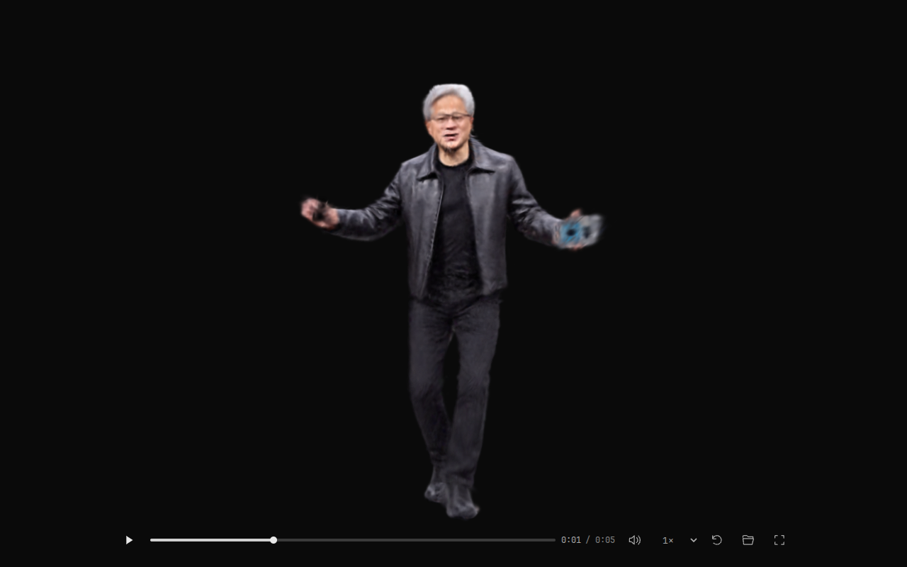

# FTGS Player

A reusable browser player for animated `.ftgs.ply` and packaged `.tsog` scenes.
It provides a canvas API for your own UI, an iframe API for the hosted player,
and a small standalone website. Rendering uses WebGL2 and a sorting worker;
there are no runtime dependencies.

**[Open the player](https://opsiclear-4dgs.github.io/ftgs-player/)** ·
**[Play example](https://opsiclear-4dgs.github.io/ftgs-player/?example=jensen-2m)** ·
[Canvas example](https://opsiclear-4dgs.github.io/ftgs-player/examples/embedding.html) ·
[Iframe example](https://opsiclear-4dgs.github.io/ftgs-player/examples/embedding.html?mode=iframe)

[](https://opsiclear-4dgs.github.io/ftgs-player/?example=jensen-2m)

Drop a file onto the page, or use the folder button. Local files stay in your
browser. Playback supports seeking, speed control, embedded audio, fullscreen, orbit/pan/zoom,
and WebXR AR on supported devices. The Jensen example loads all 2M Gaussians,
uses its saved camera, and includes audio in a 45.1 MB TSOG. It downloads only
when selected, using small byte-range requests with download progress and bounded
retries. [Example provenance and download](examples/assets/README.md).

The website follows [COLMAPView's design system](https://colmapview.github.io/):
neutral dark panels, silver accents and compact icon controls.
[Theme and layout notes](docs/DESIGN.md).
The embedding examples include speed and fullscreen controls at the bottom
right and copyable integration code beneath the player. The code follows the
selected Canvas or Iframe mode. Audio starts enabled; when the browser blocks
autoplay with sound, press Play to start both the scene and its audio.

## Reuse the player

Install from GitHub; the package is not published to the npm registry:

```bash
npm install github:OpsiClear-4DGS/ftgs-player
```

```js
import { FTGSPlayer } from "@opsiclear/ftgs-player";

const player = new FTGSPlayer(document.querySelector("canvas"), {
  autoplay: false,
  maxPoints: Infinity,
});
await player.load("./assets/scene.tsog");
player.play();
// Call player.destroy() when your component unmounts.
```

Give the canvas a CSS width/height and `touch-action: none`. The library does
not add controls, global styles, document titles, or page-wide shortcuts.
Your host owns the UI; the player owns rendering, camera interaction and playback.

For a build-free application, copy `src/` with its relative paths intact and
import `src/index.js`. The root `index.js`, `player.js` and `embed.js` remain
stable browser entry points. Self-host canvas modules so the sorting worker
loads from the application's origin; bundlers must preserve the module worker.
The npm package includes the source, worker, schema and license notices and
excludes website UI, tests and recorded example data.

For an iframe, create a controller after appending the iframe:

```js
import { FTGSEmbed } from "@opsiclear/ftgs-player";

const frame = document.querySelector("iframe");
frame.allow = "autoplay; xr-spatial-tracking";
const player = new FTGSEmbed(frame, {
  src: "https://opsiclear-4dgs.github.io/ftgs-player/?autoplay=0&points=all",
});
await player.ready;
await player.load("https://your-host.example/scene.tsog");
await player.play();
// Call player.destroy() to unload the child and remove listeners.
```

A plain iframe can instead use the [Jensen demo URL](https://opsiclear-4dgs.github.io/ftgs-player/?example=jensen-2m).
The [iframe example](https://opsiclear-4dgs.github.io/ftgs-player/examples/embedding.html?mode=iframe)
shows a complete HTML embed below the player, with a Copy code button. Use the
[canvas example](https://opsiclear-4dgs.github.io/ftgs-player/examples/embedding.html?mode=canvas)
for a JavaScript integration with modules served from your own project.
Cross-origin model hosts must allow CORS. See the [full API reference](docs/API.md)
for events, camera bookmarks, independent instances, cancellation, audio and
React component lifecycle examples.

## Share on X

The player and embedding-example pages include static X Player Card and Open
Graph tags, credited to **@Yeheliu**, with a 1200×675 preview picture and a
[five-second video preview](examples/social-player.html). The card offers a
960×540 H.264/AAC MP4 with the original example audio; the shared page opens the
interactive 4D player. The preview page starts paused with sound enabled.

These tags follow [X's official Player Card example](https://github.com/xdevplatform/cards-player-samples).
X controls whether a post shows inline playback or an image/link preview.
The static card always uses the retained Jensen example, including when a URL
selects Canvas or Iframe mode. Metadata and assets can be checked in a browser;
actual card rendering must be checked on X. [Preview provenance and regeneration](examples/assets/README.md#social-preview).

## Project layout

```text
src/              Reusable player, decoders, renderer and sorting worker
site/             Standalone UI, styles, iframe bridge and synthetic demo
examples/         Canvas/iframe hosts and the retained Jensen 2M result
docs/             Guides, specification, development instructions and license notices
tests/            Unit/browser checks, fixtures and Python test requirements
tools/            Static-site build and TSOG packaging/validation CLIs
```

The root contains the README, license, package definition, website entry and
stable browser module entry points. Documentation lives in `docs/`; the
published schema stays at `tsog.schema.json` so existing schema URLs keep working.

## Develop and deploy

Node.js 22+ is used for tooling. The browser player itself needs no install
or build step. From the repository root:

```bash
npm test
npm run validate:example
npm run serve
```

Open <http://localhost:8765/>. `npm run serve` uses Python 3's static server.

```bash
npm run build
npm pack
```

`dist/` is the complete static website, including the example; serve it from any
HTTP(S) static host. `npm pack` creates the small reusable library archive
without the 45 MB scene. No generated files are committed.

GitHub Pages currently deploys `main` at the repository root. The same relative
URLs work at `/ftgs-player/`, the local root, and the built `dist/` deployment.
[Contributing](docs/CONTRIBUTING.md) covers browser checks and release validation.

## Documentation and license

- [Canvas and iframe API](docs/API.md)
- [Player controls, URL settings and audio](docs/PLAYER.md)
- [FTGS v1 format](docs/FORMAT.md)
- [TSOG guide](docs/TSOG.md), [playback specification](docs/TSOG-SPEC.md), and [metadata schema](tsog.schema.json)

Code is **AGPL-3.0-only**, originating from the player in
[FreeTimeGsVanilla](https://github.com/OpsiClear-4DGS/FreeTimeGsVanilla).
Retain [LICENSE](LICENSE) and [third-party notices](docs/THIRD_PARTY.md) when reusing
or distributing the library. The recorded example's source media and audio
retain their original rights, described with its provenance.
